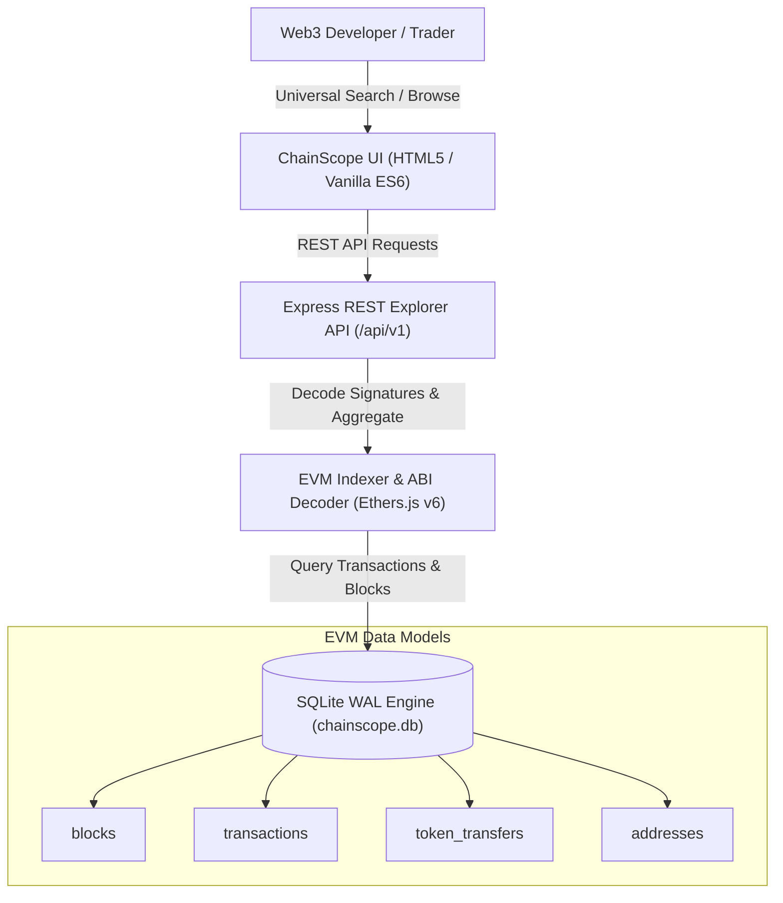

# ChainScope | EVM Blockchain Transaction Explorer & Portfolio Indexer

[](https://github.com/Soulofghost/chainscope/actions)
[](LICENSE)
[](https://nodejs.org/)
[](https://docs.ethers.org/)
[](https://www.sqlite.org/)

---

## 1. Project Introduction

**ChainScope** is a high-performance EVM block explorer, transaction decoder, and address portfolio indexer engineered for Web3 developers, security auditors, and DeFi institutions. Built with Node.js, Ethers.js v6, and transactional SQLite Write-Ahead Logging (WAL), ChainScope delivers sub-second block queries, 4-byte ABI calldata translation, real-time gas dynamics, and cross-contract ERC-20 token tracking without external rate limits.

---

## 2. Problem Statement

Modern smart contract developers and decentralized finance operations frequently run into operational friction with public block explorers:
- **API Throttling & Rate Limits:** Commercial explorers impose aggressive query limits, breaking automated test runners, local testnets (Anvil/Hardhat), and custom telemetry pipelines.
- **Calldata Obfuscation:** Raw transaction inputs are difficult to decipher without manual ABI uploading.
- **Bloated UI Overhead:** Standard explorers are bogged down with banner advertisements, tracking scripts, and slow page transitions.

---

## 3. Proposed Solution

ChainScope provides a self-hosted, lightweight EVM indexing layer:
- **Universal Multi-Format Search:** Seamlessly resolves raw transaction hashes, 42-character Ethereum addresses, or block numbers with zero query ambiguity.
- **4-Byte Method Disassembly:** Automatically identifies and decodes common EVM function selectors (ERC-20 transfers, approvals, DEX swaps, and L2 bridge deposits).
- **Embedded WAL Indexer:** Eliminates bulky external database dependencies while retaining high-throughput read/write concurrency.

---

## 4. Key Features

- **Real-Time Network Ticker:** Live monitoring of current block height, base fee per gas (EIP-1559), average transaction fee, and gas limit utilization.
- **Dual-Stream Live Feed:** Synchronized split-view displaying mined blocks alongside pending/confirmed transactions.
- **Address Portfolio Profiler:** Consolidated address dashboard displaying native Ether balances, smart contract indicators, and historical transactions.
- **ERC-20 Token Event Parser:** Extraction and attribution of token movements from EVM logs.
- **Raw Calldata Inspector:** Formatted hex inspector for verifying contract invocation payloads.

---

## 5. Architecture Diagram



---

## 6. Technology Stack

- **Runtime:** Node.js v22+
- **Blockchain Library:** Ethers.js v6.13
- **Web Framework:** Express.js 4.19
- **Database Engine:** `node:sqlite` (SQLite 3 WAL)
- **Frontend:** Vanilla TypeScript-ready ES6, Space Grotesk, JetBrains Mono, Inter typography
- **DevOps:** Docker, Docker Compose, GitHub Actions CI
- **Automated Testing:** Node native test runner (`node:test`, `node:assert/strict`)

---

## 7. Folder Structure

```
chainscope/
├── .github/
│   └── workflows/
│       └── ci.yml
├── backend/
│   ├── src/
│   │   ├── engine/
│   │   │   └── explorer.js
│   │   ├── routes/
│   │   │   └── explorerRoutes.js
│   │   ├── db.js
│   │   └── server.js
│   ├── tests/
│   │   └── explorer.test.js
│   ├── package.json
│   └── package-lock.json
├── frontend/
│   ├── app.js
│   ├── index.html
│   └── style.css
├── .env.example
├── .gitignore
├── docker-compose.yml
├── Dockerfile
├── LICENSE
└── README.md
```

---

## 8. Installation Instructions

### Prerequisites
- Node.js 22.x or later
- npm or yarn

### Setup Steps
```bash
git clone https://github.com/Soulofghost/chainscope.git
cd chainscope/backend
npm install
npm start
```

Access the explorer at `http://localhost:8008`.

---

## 9. Environment Configuration

Copy `.env.example` to `.env`:
```bash
cp .env.example .env
```

| Variable | Default Value | Description |
| :--- | :--- | :--- |
| `PORT` | `8008` | Web server port |
| `CHAINSCOPE_DB` | `./backend/data/chainscope.db` | SQLite database file location |
| `NODE_ENV` | `development` | Runtime environment flag |

---

## 10. Database Setup

Database schema, indexes, and demonstration blocks/transactions are initialized automatically on launch via `initDb()`:
```javascript
import { initDb } from './src/db.js';
initDb();
```

---

## 11. API Documentation

### Primary Endpoints

| Method | Endpoint | Description |
| :--- | :--- | :--- |
| `GET` | `/api/v1/health` | Service health status check |
| `GET` | `/api/v1/network/stats` | Real-time gas price, base fee & block height |
| `GET` | `/api/v1/blocks` | List recent mined blocks |
| `GET` | `/api/v1/blocks/:identifier` | Retrieve block details by height or hash |
| `GET` | `/api/v1/transactions` | List recent transactions |
| `GET` | `/api/v1/transactions/:hash` | Detailed transaction receipt & decoded input |
| `GET` | `/api/v1/addresses/:address` | Address portfolio balance & history |
| `GET` | `/api/v1/search?q=...` | Classifies query into block, transaction, or address |

---

## 12. Application Interface Overview

ChainScope features a high-density, dark Web3 terminal aesthetic:
- **Real-Time Network Ticker:** Immediate visibility into network congestion and base fees.
- **Universal Search:** Instant auto-detection between addresses, hashes, and block heights.
- **Split Live Feed:** Parallel view of mined blocks alongside transactions.
- **Transaction Inspector:** Full calldata breakdown, fee economics, and ERC-20 transfer logs.

---

## 13. Testing Instructions

Execute the automated test suite using the Node.js test runner:

```bash
cd backend
npm test
```

Expected output:
```
▶ ChainScope EVM Explorer Engine Tests
  ✔ Database seeds initial EVM blocks and transactions
  ✔ getNetworkStats returns real-time EVM metrics
  ✔ getBlockByIdentifier retrieves block by integer height and hex hash
  ✔ getTransactionByHash returns transaction with gas metrics and token transfers
  ✔ getAddressProfile aggregates ETH balance and transaction activity
  ✔ decodeMethodSignature translates 4-byte EVM selectors to human signatures
  ✔ classifySearchQuery accurately identifies block, transaction, and address queries
✔ ChainScope EVM Explorer Engine Tests (21ms)
ℹ tests 7
ℹ pass 7
ℹ fail 0
```

---

## 14. Security Considerations

- **Strict Hex Validation:** Regular expressions validate Ethereum addresses (`^0x[a-fA-F0-9]{40}$`) and transaction hashes (`^0x[a-fA-F0-9]{64}$`).
- **Parameterized SQL:** All database statements use prepared queries, eliminating SQL injection risks.
- **Client-Side Sanitization:** Input escaping protects against XSS when rendering contract calldata or labels.

---

## 15. Deployment Instructions

### Docker Deployment
```bash
docker compose up -d --build
```
Access the application at `http://localhost:8008`.

---

## 16. Known Limitations

- Real-time indexing currently uses embedded WAL database with demonstration feeds; connecting to live networks requires configuring an RPC node endpoint (Infura / Alchemy / local Anvil).

---

## 17. Future Roadmap

- [ ] Direct JSON-RPC WebSocket listener for live Sepolia and Ethereum Mainnet sync.
- [ ] Contract source code verification via Solidity compiler integration.
- [ ] Internal transaction trace visualizer for nested smart contract calls.
- [ ] ERC-721 and ERC-1155 NFT transfer decoding.

---

## 18. License

SPDX-License-Identifier: MIT
Copyright (c) 2026 Alvin MS (@Soulofghost). All rights reserved.
